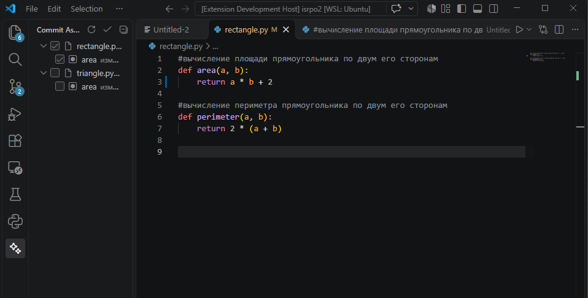
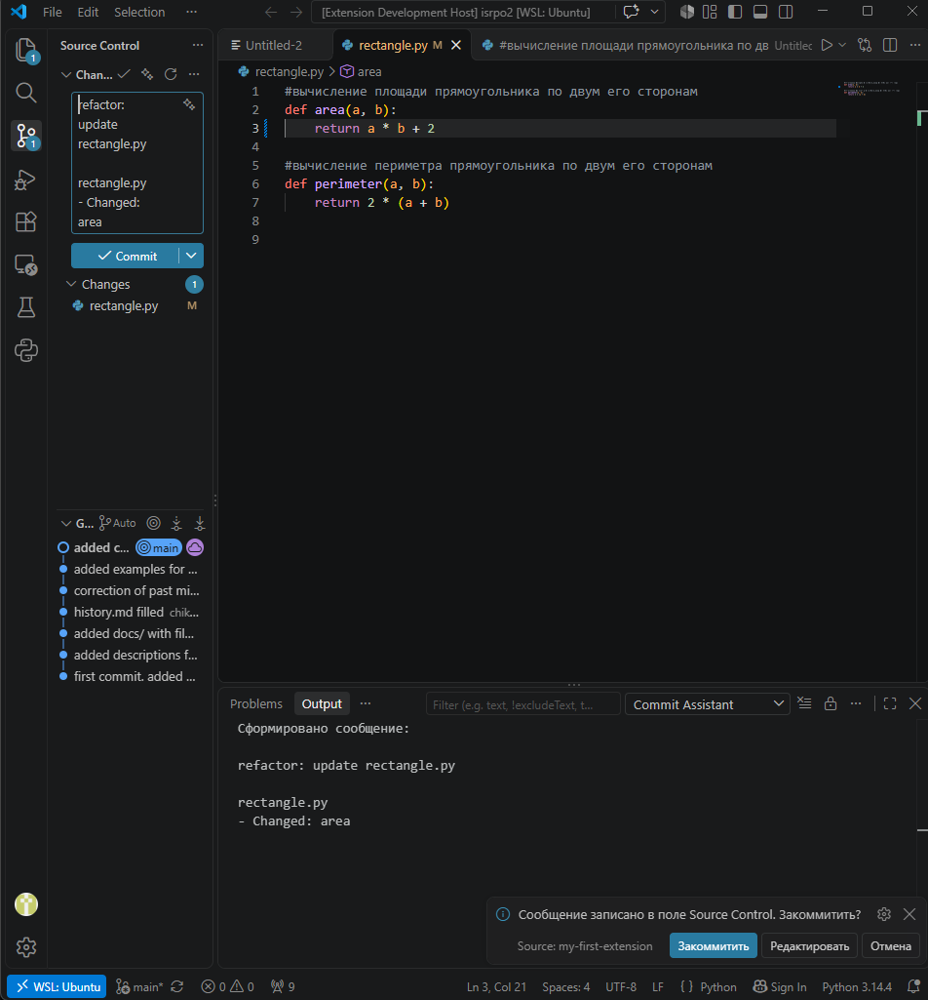

# my-first-extension (Commit Assistant)

Расширение для VS Code, которое формирует сообщение коммита по изменённым
функциям и классам. Оно сравнивает текущую версию файла с последним коммитом,
определяет, какие функции добавлены, изменены или удалены, и собирает из этого
сообщение в формате Conventional Commits. Перед коммитом сообщение можно
проверить и отредактировать.

## Возможности

- Определение изменённых функций и методов: добавлена, изменена, удалена.
- Сообщение коммита вида `тип: update файл` и список функций по каждому файлу.
- Боковая панель Commit Assistant с деревом изменений (файл → функция) и
  чекбоксами: что отмечено, то попадёт в сообщение.
- Выбор типа коммита (`feat`, `fix`, `refactor`, `docs`, `test` и др.).
  Расширение предлагает тип автоматически, но решает пользователь.
- Редактирование сообщения в поле Source Control перед коммитом.
- Запуск по горячей клавише, кнопке в Source Control или из палитры команд.

## Использование

1. Откройте папку с git-репозиторием и внесите изменения в код.
2. Нажмите `Ctrl+Alt+G` (на macOS `Cmd+Alt+G`) или кнопку со звёздочкой
   в заголовке вкладки Source Control.
3. Выберите тип коммита из списка.
4. Сообщение появится в поле Source Control. Нажмите «Редактировать», чтобы
   поправить текст, или «Закоммитить», чтобы создать коммит.

Детальный сценарий через боковую панель:

1. Откройте панель Commit Assistant в левой полосе значков.
2. Нажмите «Обновить», чтобы заново проанализировать изменения.
3. Снимите галочки с файлов или функций, которые не нужно упоминать
   в сообщении. Текст в поле Source Control обновляется сразу.
4. Нажмите кнопку с галочкой в заголовке панели, чтобы перейти к коммиту.




## Команды

| Команда | Описание |
|---|---|
| Commit Assistant: Generate Commit Message | Анализ изменений и запуск сценария коммита (`Ctrl+Alt+G`) |
| Commit Assistant: Refresh Changes | Обновить дерево изменений |
| Commit Assistant: Commit Selected | Коммит по отмеченным в дереве элементам |
| Hello World | Тестовая команда из методических материалов |

## Требования

- VS Code 1.140.0 или выше.
- Установленный git.
- Для определения функций нужно расширение языка, которое отдаёт структуру
  файла. Для Python это расширение Python (Microsoft), для TypeScript и
  JavaScript поддержка встроена.

## Ограничения

- Галочки в дереве влияют только на текст сообщения. В коммит попадают те же
  файлы, что и при обычном коммите: добавленные через `git add`, а если таких
  нет, то все изменённые.
- Тип коммита определяется по простым правилам и может не совпадать с
  намерением автора, поэтому его нужно подтвердить.
- Если файл удалён целиком, его функции могут не определиться как удалённые.
- Если языковое расширение недоступно, функции не будут найдены, и изменения
  попадут в строку «Other changes».

## Структура проекта

- `src/extension.ts`: регистрация команд и панели, сценарий коммита.
- `src/analysis.ts`: работа с Git API и анализ одного файла.
- `src/diffParser.ts`: разбор diff в номера добавленных и удалённых строк.
- `src/symbolMapper.ts`: сопоставление строк с функциями.
- `src/messageBuilder.ts`: определение типа и сборка текста сообщения.
- `src/changesTree.ts`: дерево изменений с чекбоксами.

## Сборка и установка

```bash
npm install
npm run compile
vsce package
```

Полученный `.vsix` устанавливается через Extensions → `...` → Install from VSIX.